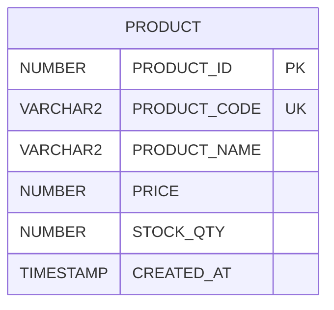

# 상품 ERD · Oracle 연동 설계

상품 관리의 첫 버전은 PRODUCT 한 테이블로 구성한다. 한 행은 판매 상품 한 종류이며 STOCK_QTY에는 현재 재고 수량을 기록한다.

| Oracle 열 | 자료형 | 제약·기본값 | API 대응 |
|---|---|---|---|
| PRODUCT_ID | NUMBER(10) | 기본 키, GENERATED ALWAYS AS IDENTITY | productId |
| PRODUCT_CODE | VARCHAR2(30 CHAR) | 고유 키 | productCode |
| PRODUCT_NAME | VARCHAR2(100 CHAR) | 필수 | productName |
| PRICE | NUMBER(12,2) | 0 이상, 기본값 0 | price |
| STOCK_QTY | NUMBER(10,0) | 0 이상, 기본값 0 | stockQty |
| CREATED_AT | TIMESTAMP | 기본값 SYSTIMESTAMP | DB 내부 기록 |

모든 열은 NULL을 허용하지 않는다. PRODUCT_ID는 행을 식별하므로 상품코드를 수정해도 유지된다. PRODUCT_CODE의 고유 제약은 동시에 같은 코드가 등록되는 경우에도 중복 저장을 막는다.
