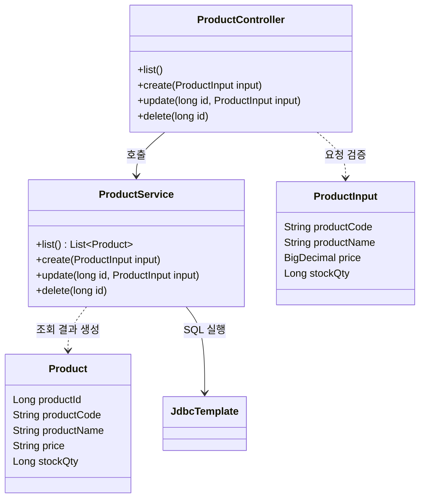
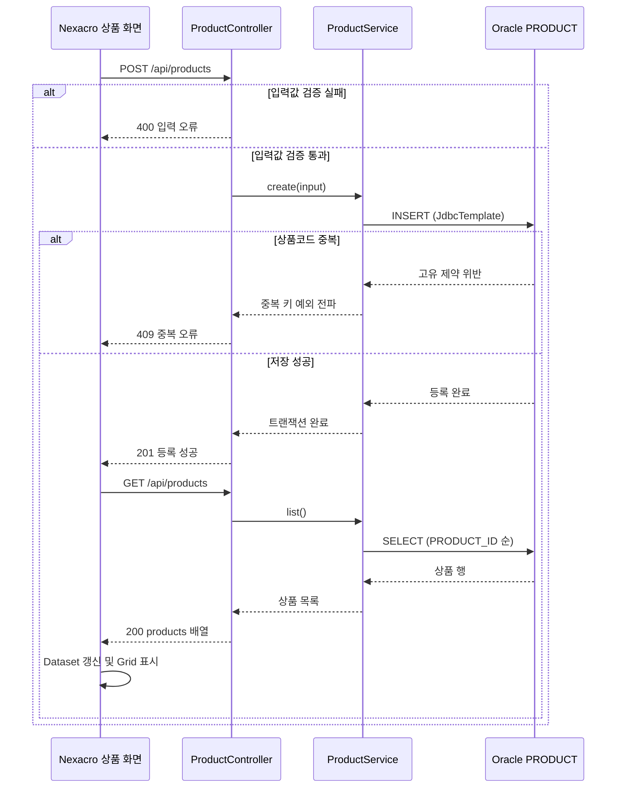

# 상품 관리 UML

## 클래스 다이어그램 · Oracle 연동 후

현재 ProductController는 ProductList에 샘플 Product를 담아 반환한다. 아래는 DB 연동 후의 구조다. 컨트롤러가 HTTP 요청과 응답을 맡고 ProductService가 JdbcTemplate으로 SQL을 실행한다.

## 시퀀스 다이어그램 · 상품 등록과 목록 갱신

그림에서 400·409 응답은 컨트롤러 계층의 예외 처리기(ApiExceptionHandler)가 작성한다. 등록 성공 뒤 재조회하면 Oracle이 생성한 productId를 화면에서도 사용할 수 있다.
